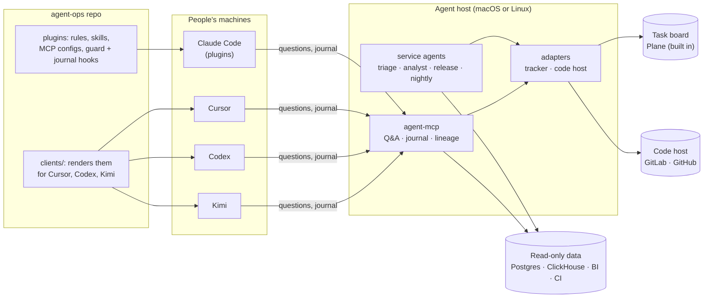

  

<h1 align="center">agent-ops</h1>

<b>One source of truth for every AI agent on your team: same rules, same skills, same safety, in every tool.</b> 
Claude Code · Cursor · Codex · Kimi — macOS · Linux · Windows — MIT licensed

---

Your team already uses AI coding agents: one person in Claude Code, another in Cursor, someone else
trying Codex or Kimi. Each agent follows its own habits, reads its own copy of the "how we work"
notes, and a single prompt could write to a production database, trigger a deploy or quietly change
a task board.

**agent-ops** turns that into one system you can read, review and trust:

- **The same rules and skills for everyone.** One git repo holds the team's rules, skills, MCP
  server configs and safety hooks. It is published as a Claude Code plugin marketplace and rendered
  for Cursor, Codex and Kimi, so changing a rule is one pull request.
- **Hard safety rules that hold whatever the prompt says.** No database writes, deploys, merges,
  CI runs or deleted tasks. Read-only credentials enforce them first, a guard hook on every tool
  call second.
- **Every change has an author and an undo.** The action journal records each write any agent
  makes: who, which agent or run, the value before. `blame`, `suspects` and `revert_plan` answer
  "who changed this", "what broke it" and "how do I undo it".
- **Unattended teammates.** Service agents on a small always-on host:
  - triage sorts and routes the task board every few minutes;
  - an analyst finds root causes and plans features, with evidence;
  - release gates merges with a commit status;
  - nightly writes the standup and files findings.
- **Answers about the whole project.** agent-mcp lets anyone's agent ask a read-only project agent
  about repos, data, CI and history it can't see itself.

## How it fits together

## Features

| | |
|---|---|
| **Guard** | A `PreToolUse` hook that blocks database writes, merges, deploys, CI runs, deletes and pushes to `main`, for every role. DevOps can run non-production jobs. It covers GitLab, GitHub, Plane, Postgres, ClickHouse, Metabase, Jenkins and shell commands. |
| **Action journal** | Every write tool call is recorded with its author and the value before. `blame`, `suspects` and `revert_plan` read it. A person applies reverts in a terminal; agents can't edit the journal. |
| **Lineage** | Built from your code and warehouse catalog: table → view → API route → page → metric. Lookups go `impact` (what changes downstream) and `upstream` (what it's built from). Scanners are pluggable. |
| **Quality** | A fresh-context reviewer checks the analyst's claims against their sources. Every analysis and answer gets an unsourced-claim rate. Data-trap checks run nightly and on every release. |
| **Service agents** | triage, analyst, release, nightly. Each runs as `claude -p` on a schedule, with a precheck that skips idle ticks, a budget gate and a circuit breaker. |
| **agent-mcp** | Remote MCP server. Project Q&A with sources, teammate messages (Telegram), and the journal and lineage tools. Callers sign in with their own task-board token. |
| **Desks** | Long-running personal sessions, each owning one area (BI, CI jobs, debugging), with shared rules and private state. |
| **Adapters** | The task board and code host sit behind small interfaces: Plane, GitLab and GitHub are built in; Jira, Linear and others are a single file each ([infra/adapters](infra/adapters/README.md)). |
| **Reference** | A generated, searchable reference page from the repo, its git timeline and the agents' run logs. |

## Quick start

1. Fork or clone this repository.
2. Open it in Claude Code, Codex, Kimi or Cursor and say:
   > Follow SETUP.md.
3. The agent asks every question up front, then installs, configures and checks each part. The
   questions cover:
   - your team and roles, and which AI tool each person uses;
   - your task board and code host;
   - the host machine;
   - which service agents to run, their schedules and the budget.
   You type every secret yourself, in hidden input, never in the chat.

Prefer to read first? Start with [docs/architecture.md](docs/architecture.md) and
[docs/security.md](docs/security.md).

## Supported tools and platforms

| | Claude Code | Cursor | Codex | Kimi |
|---|---|---|---|---|
| Team rules and skills | ✅ plugins | ✅ rendered | ✅ rendered | ✅ rendered |
| MCP servers | ✅ | ✅ | ✅ | ✅ |
| Guard (blocks unsafe calls) | ✅ hook | ✅ hook | ✅ hook | see [docs/clients.md](docs/clients.md) |
| Action journal | ✅ hook | ✅ hook | ✅ hook | see [docs/clients.md](docs/clients.md) |

People's machines: macOS, Linux, Windows. Agent host: macOS (launchd) or Linux (systemd).
Task board: Plane (self-hosted or cloud). Code hosts: GitLab and GitHub (including Enterprise).
Optional data sources: Postgres, ClickHouse, Metabase, Jenkins, Figma.

## Security model

- **Credentials first.** Agents get read-only database users, read-only code-host tokens and a
  CI user without build rights.
- **Guard second.** A hook on every tool call blocks what a prompt might still try.
- **Deny lists third.** Service agents run with explicit allow/deny lists.
- **Accountability.** Every write is journaled. Revert tokens live in a file no agent loads.
- **No leaks in the repo.** CI fails on emails, private IPs, private hostnames and a deny-list of
  terms.

Details: [docs/security.md](docs/security.md).

## Contributing

Issues and pull requests are welcome. Read [CONTRIBUTING.md](CONTRIBUTING.md); coding agents read
[AGENTS.md](AGENTS.md). `bash tools/lint.sh && bash tools/run-tests.sh` must pass.

## License

[MIT](LICENSE)
