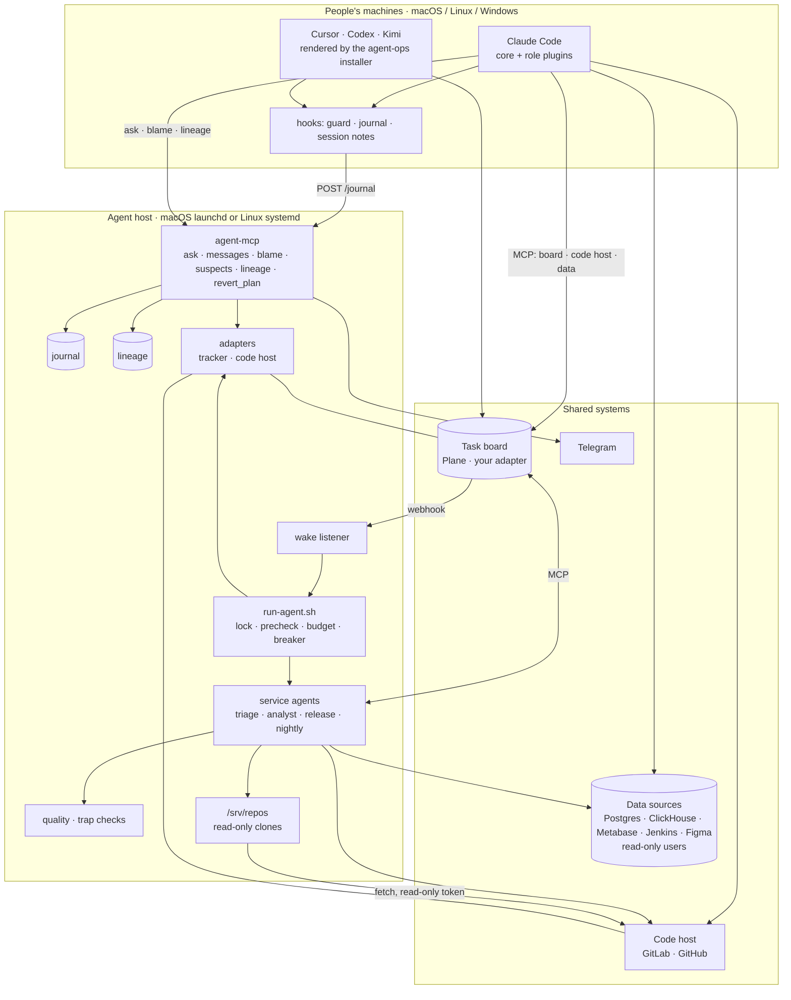

# Architecture

agent-ops has two halves that share one repository: **people's agents** (Claude Code, Cursor, Codex
or Kimi on each person's machine) and **service agents** on an always-on **agent host**. They meet
on the **task board**; everything they do to shared systems goes through read-only credentials, the
**guard**, and the **action journal**.

## Layers of safety

1. **Credentials** decide what is possible: read-only database users, a CI user without build
   rights, Developer-only code-host access with `main` protected, read-only tokens for the agents.
2. **The guard** (`plugins/core/scripts/guard.sh`) decides what an agent may try: it blocks
   database writes, CI runs, merges and deploys, pushes to `main`, deletions on the board, and more.
3. **Allow lists** decide what a service agent can call at all (`defaultMode: dontAsk`).
4. **The journal** records what happened, with the value before, so it can be blamed and undone.

## Where to go next

- `docs/reference/` — the full reference, built into one HTML page by `docs/reference/build.py`.
- `docs/security.md` — the security model.
- `docs/clients.md` — what each AI tool supports.
- `infra/adapters/README.md` — adding a task board or code host.
