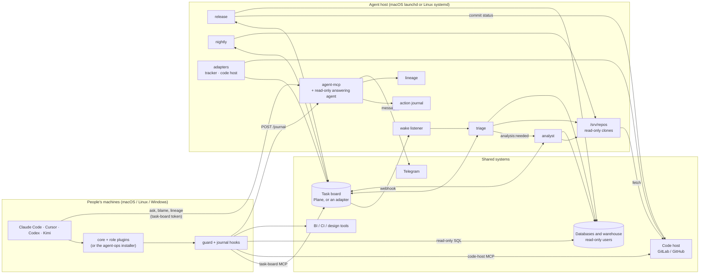

# Overview

## What agent-ops is

agent-ops is one git repository that runs every AI agent of a small product team: the agents each
person uses on their own machine, and unattended "service agents" on an always-on host. It holds
the rules, skills, MCP server configs, safety hooks, schedules and setup for all of them, so the
whole team's agents behave the same way and a change to how they work is a reviewed merge request.

It is built for teams of roughly 3–15 people who already use Claude Code, Cursor, Codex or Kimi and
want them to work as a team: on one task board, inside clear limits, with every change attributable
and reversible. The examples throughout use a made-up company, **Acme**, with three projects:
**BIL** (Acme Billing, the default), **PRC** (Acme Pricing) and **ANL** (Acme Analytics), and seven
people:

| Key | Name | Role | Notes |
|---|---|---|---|
| alex | Alex Morgan | backend | tech lead, approver, question owner, the only person who merges to `main` |
| sam | Sam Rivera | product | approver |
| riya | Riya Kapoor | design | |
| noor | Noor Haddad | frontend | |
| kenji | Kenji Sato | data | lead and question owner of ANL |
| omar | Omar Farouk | backend | second backend on PRC |
| lena | Lena Fischer | devops | |

Your own team goes in `routing.yaml`, `projects.yaml` and `people.yaml` (git-ignored); `SETUP.md`
writes them for you.

It gives every agent:

1. **One task board.** A task board (Plane out of the box, others through an adapter) is the only
   shared channel. Agents talk to each other through work items and comments, never directly
   (`plugins/core/skills/task-protocol/SKILL.md`). People see everything the agents do.
2. **Hard safety rules** that hold whatever a prompt says. They are enforced by read-only
   credentials first, a `PreToolUse` guard hook second, and (for service agents) permission allow
   lists third (`plugins/core/skills/scope-guard/SKILL.md`, `plugins/core/scripts/guard.sh`).
3. **An action journal.** Every write any agent makes is recorded with its author and the value
   before, so you can ask "who changed this, and how?" and undo it (`infra/journal/`).
4. **The same rules for everyone.** Claude Code installs the plugins from this repo's marketplace;
   Cursor, Codex and Kimi get the same rules, skills, MCP servers and guard through the `agent-ops`
   installer (`clients/`). Service agents read the repo directly and pull it before every run.

## The pieces at a glance

### Plugins (people's agents)

`.claude-plugin/marketplace.json` defines a Claude Code plugin marketplace. `core` is for everyone:
the task protocol, scope guard, hand-off, lessons, blame-and-revert and data-query skills; the
task-board MCP server; the agent-mcp client; the guard, journal and session-notes hooks. One
`role-*` plugin per role adds that role's skills and tools: `role-product`, `role-design`,
`role-backend`, `role-frontend`, `role-data`, `role-devops`. `metabase-tools` is a vendored
Metabase MCP server. Details: section 02.

### Clients

The `agent-ops` installer (`clients/`) renders the same plugins for Cursor, Codex and Kimi on macOS,
Linux and Windows: skills, always-on rules, MCP servers (secrets in the OS keychain, never in
config files), and the guard and journal hooks. Section 02 has the support matrix.

### Service agents (unattended)

Each lives in `service/<agent>/` with its own `CLAUDE.md` (role), `tick.md` (the prompt for one
run), `.mcp.json`, `.claude/settings.json` (allow and deny lists, the hooks) and skills.
`infra/bin/run-agent.sh <agent>` runs one tick with `claude -p` in that folder.

- **triage** (every 5 minutes, plus an instant wake on board changes): sorts new items on every
  project's board, investigates read-only, writes triage notes, picks the team, sets a default
  priority and an effort label, splits, assigns and moves to `Todo`. Queues bugs and features of
  effort `s` or more for the analyst. Enforces who may move items to review states.
- **analyst** (every 10 minutes, one item per run, a stronger model): writes an `## Analysis`
  section with evidence for every claim. For a bug: reproduce, trace, root causes and fix options.
  For a feature: what exists, approaches and a plan per team. A fresh, context-free reviewer checks
  each cited source before it posts.
- **release** (every 15 minutes): for each open merge request into `main`, reads the CI end-to-end
  report, runs read-only data checks and the data-trap checks the change reaches, and posts one
  commit status that gates the merge.
- **nightly** (once a night): brings the boards in line with the day's merged work, files
  findings (failing tests, vulnerable dependencies, leaked secrets, failing data checks), and
  writes a morning standup report.

### agent-mcp (project Q&A, messaging, blame, lineage)

`infra/agent-mcp/server.py` is an MCP server on the host. A teammate's agent, authenticated with
that person's task-board token, can ask a read-only headless agent about any part of a project it
can't see itself (other repos, the warehouse, CI, history) and get a sourced answer. It also sends
private Telegram messages between teammates, records the journal (`POST /journal`), and answers
`blame`, `suspects`, `lineage` and `revert_plan`.

### Action journal, lineage and quality

- **Journal** (`infra/journal/`): who changed what, the value before, how to undo it. Agents
  prepare revert plans; a person applies them in a terminal on the host.
- **Lineage** (`infra/lineage/`): a graph of warehouse table → view → API route → page → metric,
  scanned from your repos and the warehouse catalog, plus a small hand-kept file for metrics and
  owners.
- **Quality** (`infra/quality/`): the unsourced-claim rate of every analysis and agent-mcp answer,
  and data-trap checks: read-only SQL checks with thresholds that nightly runs and release uses
  as a gate.

### Desks (optional)

`desks/` is a template for a person's long-running interactive sessions, one per area (a BI desk,
a CI desk, a debugging desk…), each with a shared `DESK.md` and a local `STATE.md`. See section 08.

### Infrastructure

The host is any always-on macOS or Linux machine (launchd or systemd), running the service agents,
agent-mcp, an instant-wake listener, optionally a self-hosted Plane and n8n for notifications, and
read-only clones of your repositories under `/srv/repos`. Everything that talks to the task board or
the code host goes through two small adapters (`infra/adapters/`). Section 04.

## How the pieces connect

## The hard rules and how each is enforced

The rules live in `plugins/core/skills/scope-guard/SKILL.md`. Enforcement has three layers:

1. **Credentials** (the real guard): read-only database users, a CI user without build rights,
   code-host Developer (not Maintainer) access with `main` protected, read-only code-host tokens for
   service agents.
2. **The guard hook** `plugins/core/scripts/guard.sh`: pure bash/grep/sed, so it runs on every
   machine. It reads the tool call JSON on stdin and exits 2 with `BLOCKED by agent-ops guard: …`.
   People's agents get it from the core plugin's `hooks.json`; service agents from their
   `.claude/settings.json`; Cursor, Codex and Kimi through `clients/agent_ops/guard.py`. It sees
   shell commands and MCP calls, not file edits.
3. **Allow and deny lists** (service agents only): `defaultMode: dontAsk`, so anything not allowed
   is refused without a prompt.

| # | Rule | Credential | Guard |
|---|---|---|---|
| 1 | **No writes to any database.** If a write is needed, the SQL goes into the task for a person to run. | Read-only database users. | Write tools of database MCP servers are blocked; the SQL of every tool on a server whose name contains `postgres`, `clickhouse` or `metabase` is scanned for write/DDL keywords (single-quoted literals blanked first, unless the quotes don't balance). |
| 2 | **No CI job runs.** Read configs and logs only. | A CI user without build permission. | Jenkins trigger/rebuild/replay tools and their HTTP endpoints are blocked (DevOps exemption below). |
| 3 | **No merges, deployments or pipeline triggers.** Only the merge owner merges to `main`; agents open merge requests and never merge them. | Developer role; `main` protected. The release status gates the merge. | GitLab and GitHub merge, deployment, environment, schedule and pipeline-trigger tools are blocked; `git push` to `main`/`master` and force-push too. |
| 4 | **No direct database clients.** Use the read-only MCP servers. | Same read-only users. | `psql`, `clickhouse-client` and similar in any shell command. |
| 5 | **Never delete or archive** task-board items, branches, environments or other people's work. | People use their own task-board token. | Delete/archive actions on the task-board MCP. A dry-run flag makes the board read-only. |
| 6 | **Secrets never go into git, task comments or chat.** | Secrets are sensitive plugin settings in the OS keychain. | Not a guard rule; agent-mcp redacts known secret values; nightly runs gitleaks. |
| 7 | **The repo clones in `/srv/repos` are read-only references.** | Clones are fetched with read-only tokens. | Only `git -C /srv/repos/<repo> grep|log|show|ls-files|ls-tree|blame|diff|status|rev-parse`, no options that run a program or write a file. |
| 8 | **Service agents only list and read Claude artifacts.** | — | Active when `AGENT_ARTIFACTS_READ_ONLY=1` (set by `run-agent.sh`). |
| 9 | **Every agent write has an author and an undo; agents never edit that record.** | Revert tokens live in a file no agent loads. | `journal revert-apply`, `journal record` and the journal database file are blocked in shell commands. |

**The DevOps exemption.** The core plugin's hook runs `guard.sh --role "<role option>"`. With role
`devops`, CI job runs and pipeline runs are allowed only when nothing in the tool input names
production (`prod`, `prd`, `production`, `release(s)`, `main`, `master`). Retry/play calls carry only
ids, so the agent must name the pipeline's ref in the call. The role comes from argv only; service
agents never get it. The environment can only tighten the guard, never loosen it.

When a call is blocked, the agent stops and puts the request in the task for a person. It must not
rephrase, rename or split the call to get around it.

### Scope per role

`scope-guard` also sets each role's scope; work outside it goes through the `handoff` skill.

| Role | Works on | Reads only | Never touches |
|---|---|---|---|
| product | task-board items, priorities, acceptance criteria | BI, designs, dashboards | repos, databases, CI |
| design | design files, design tasks | the board, the live product | repos, databases, CI |
| backend | the backend repos, CI job definitions as files | databases, BI, CI logs, frontend repo, designs | frontend and data repo code |
| frontend | the frontend repos | designs, backend routes and API docs, the board | backend repo, databases, CI |
| data | the data repo, BI questions, warehouse SQL as files | warehouse, BI, CI logs | backend and frontend repos |
| devops | CI/CD config, Dockerfiles, deploy scripts, alert rules (as merge requests); dev/stage pipeline and job runs | pipelines, CI logs, servers, monitoring | application code, databases, anything production |

## The life of a task

All of this is in `plugins/core/skills/task-protocol/SKILL.md`, enforced in part by triage.
Most task boards can't restrict who changes a state, so triage reads each item's activity and moves
forbidden changes back.

### States

| State | Meaning | Who moves it here |
|---|---|---|
| `Backlog` | parked ideas | people (or an import job you add) |
| `Findings` | problems the nightly agent found | the nightly agent only |
| `Inbox` | new, not looked at yet | anyone creating a task |
| `Triaged` | triage investigated but couldn't hand it over (assignee not in the project) | triage |
| `Todo` | assigned, priority set, ready | triage / approvers |
| `In Progress` | being worked on | the assignee or their agent |
| `In Review` | done, waiting for review | the assignee or their agent |
| `Ready for E2E` | reviewed and approved, merged to `dev`, on stage | approvers only |
| `Done` | end-to-end green and merged to `main` | release / nightly agents, approvers |
| `Blocked` | waiting on another task or a question | anyone, with a comment saying on what |
| `Cancelled` | won't do | approvers only |

### End to end

1. **Created in `Inbox`** by a person, their agent (`write-task`, `handoff`, `figma-to-tasks`,
   `design-handoff`, `api-contract`) or a job. Every creator checks for duplicates first. The
   description template is Goal, Context/links, Acceptance criteria, Triage notes (empty).
2. **Triage** (at most 5 Inbox items per tick, across all boards) assesses effort (`effort:xs` …
   `effort:xl`). A bug or feature of effort `s` or more gets `analysis:needed` and stays in `Inbox`.
3. **Analysis.** The analyst takes one `analysis:needed` item per run, writes `## Analysis` and
   swaps the label to `analysis:done`. It never routes or moves items.
4. **Routing.** Triage, now reading the analysis, writes triage notes, picks team labels and order,
   sets a default priority, splits into children if needed, assigns and moves to `Todo`. If it can't
   decide, it opens a `question` item for the project's question owner and leaves the original in
   `Inbox`; the answer puts the item back into processing.
5. **Work.** The assignee's agent checks the task is assigned to its person, in `Todo` and not
   blocked, moves it to `In Progress` and comments. Work outside its role's scope goes through
   `handoff` (a new `Inbox` item plus a "blocked by" relation).
6. **`In Review`.** For code, the agent first runs the `reviewer` subagent and fixes what it finds,
   then moves the task to `In Review` with every link, and stops.
7. **`Ready for E2E`.** An approver reviews (`approve` skill). Approved: merge requests merged to
   `dev`, task to `Ready for E2E`. Triage reverts this move by anyone else.
8. **Release check.** On the `dev` → `main` merge request, the release agent judges the E2E report,
   data checks and trap checks, and posts its commit status. Green → `e2e:green`; red → `e2e:red`
   and the owning items back to `In Progress`.
9. **`Done`.** The merge owner merges to `main`; release moves linked green items to `Done`; nightly
   closes what release missed.

Every agent comment starts with a tag line, `[agent:<person>-<role>]` (service agents:
`[agent:triage]`, `[agent:analyst]`, `[agent:release]`, `[agent:nightly]`), then "What I did",
"Links", "Next / needs". After a failed or timed-out write, the agent reads the item back before
retrying, retries at most once, and never duplicates a comment.

## Glossary

| Term | Meaning |
|---|---|
| **task board / tracker** | Where work items live (Plane built in; others through `infra/adapters/tracker`). |
| **code host** | Where the repos live: GitLab or GitHub (`infra/adapters/codehost`). |
| **merge request** | A GitLab MR or a GitHub pull request. |
| **tick** | One run of a service agent (`tick.md` is its prompt). |
| **precheck** | A cheap script that decides, without a model, whether a tick has work. |
| **guard** | `plugins/core/scripts/guard.sh`, the `PreToolUse` hook that blocks hard-rule violations. |
| **journal** | The record of every agent write, with the value before and the undo. |
| **lineage** | The table → view → route → page → metric graph. |
| **trap check** | A read-only SQL check for a known way the data produces wrong numbers. |
| **question owner** | The person triage asks when it can't decide (`routing.yaml`). |
| **approver** | A person allowed to move items to review states, `Done` or `Cancelled`. |
